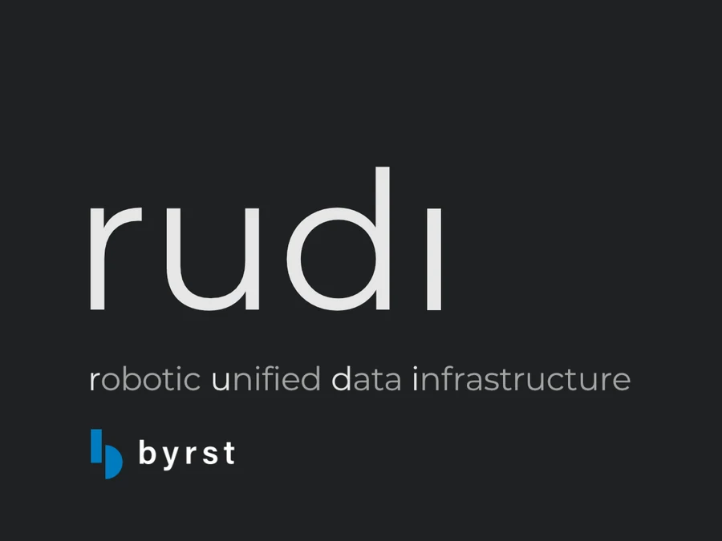

# robotic unified data infrastructure

**Unified data access inside Isaac Sim.**

rudi connects your [Byrst](https://byrst.com) account to Isaac Sim, putting your SimReady assets one click from your
scene. Bring them in, see how they behave, refine them, and share them with your team.

## Install

Download the installer from [Releases](https://github.com/byrst/rudi/releases/latest) and run it.
In Isaac Sim, open **Utilities > rudi**.

## Requirements

- Windows
- Isaac Sim 6.x
- A Byrst Enterprise account

## Support

[support@byrst.com](mailto:support@byrst.com)

---

© 2026 Byrst, Inc. · [Terms](https://cdn.byrst.com/legal/terms_conditions.html)

NVIDIA and Isaac Sim are trademarks of NVIDIA Corporation. Byrst is not affiliated with NVIDIA.
